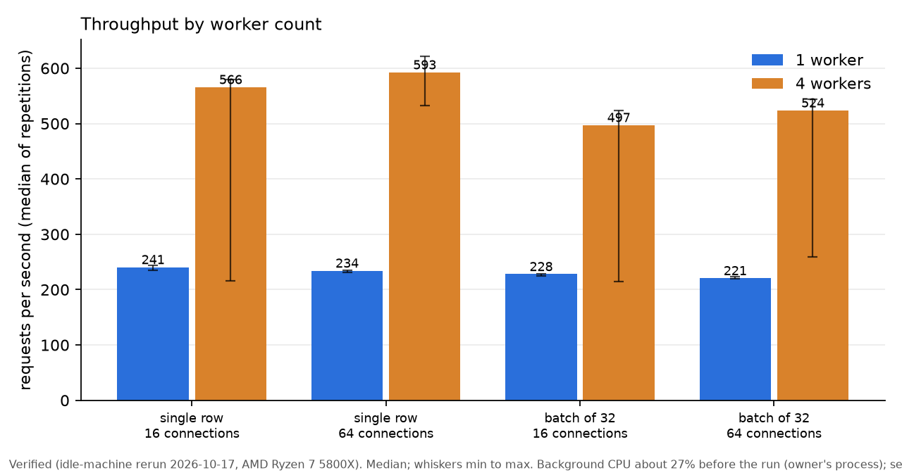
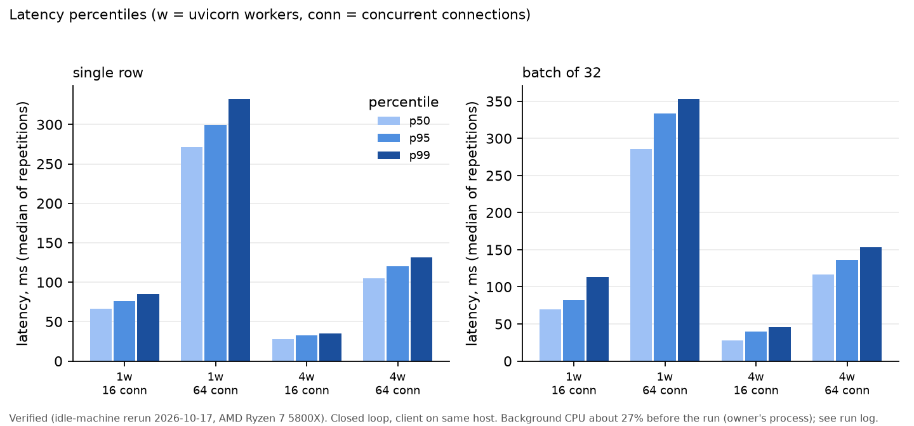
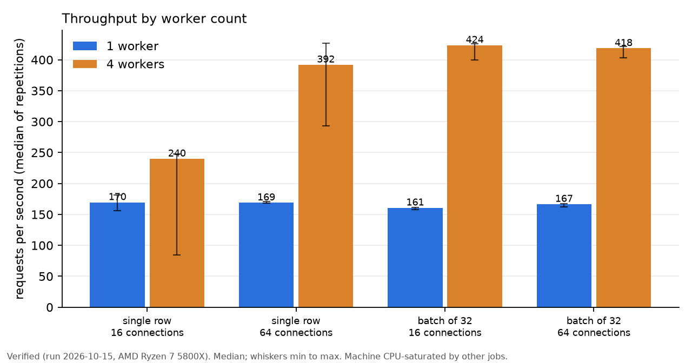
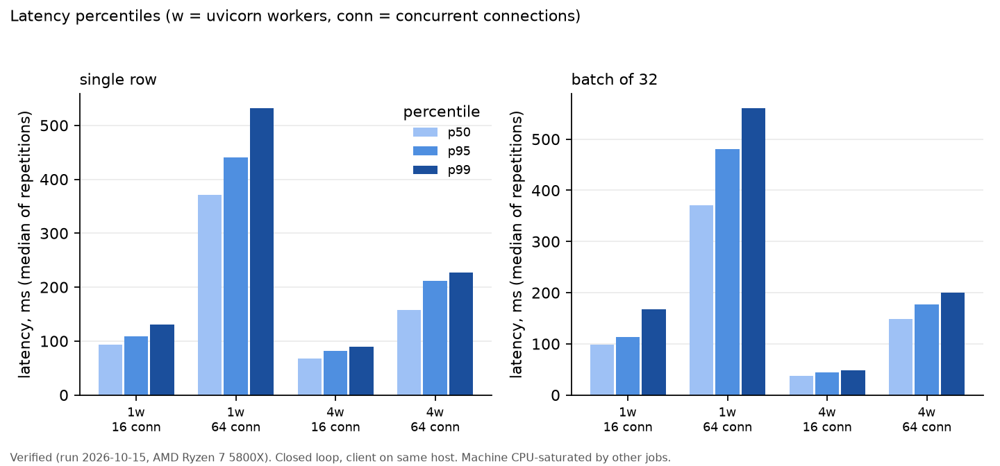
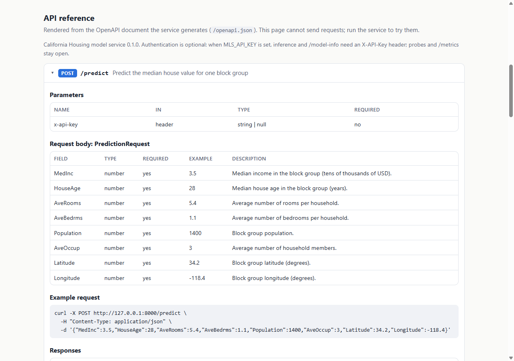

# ml-model-serving-fastapi: a small model, served the way a production service is

[](https://creativecommons.org/licenses/by-nc-nd/4.0/)

## Summary

| | Result | Status |
|---|---|---|
| What it is | A gradient-boosted regressor on California Housing behind a FastAPI service, with versioned checksum-verified artifacts, a promotion step, Prometheus metrics, request logging and a drift monitor. The model is deliberately simple; the engineering around it is the point. | |
| Model quality | Test RMSE 0.462 (95% bootstrap CI 0.441 to 0.481) in units of USD 100,000, against 1.145 for the mean predictor and 0.746 for ridge. | Verified (run 2026-10-15, seed 42, one split) |
| Tests | 171 pytest tests pass, 96.9% line and branch coverage (threshold 90%); ruff and mypy (strict) clean. | Verified (run 2026-10-15, Windows 11, Python 3.11.9) and on GitHub Actions (ubuntu-24.04, Python 3.11, same 171 tests and coverage), [run 38823370997](https://github.com/Janeferdinant/ml-model-serving-fastapi/actions/runs/38823370997) |
| Container | Multi-stage, non-root, digest-pinned base, health check; image built, hadolint-linted and smoke-tested while running. | Verified on GitHub Actions only, [run 38823370997](https://github.com/Janeferdinant/ml-model-serving-fastapi/actions/runs/38823370997): hadolint clean, build, container smoke test (11 checks), uid 10001, health `healthy`. Image size 407,437,905 bytes, not small because scikit-learn and SciPy dominate. |
| Load | 1 uvicorn worker: about 241 requests/s for single rows (16 connections: p50 67 ms, p95 76 ms, p99 85 ms). 4 workers: 566 to 593 requests/s for single rows and 497 to 524 requests/s for 32-row batches (about 15,900 to 16,800 rows/s), 2.2x to 2.5x the single worker; 22 client timeouts (30 s) in 4 of 20 four-worker repetitions. Not a capacity claim: client and server share the host. Earlier run on a shared, saturated CPU (2026-10-15): about 170 requests/s with 1 worker, 240 to 392 with 4. | Verified (low-background-load rerun 2026-10-17, AMD Ryzen 7 5800X (8 cores, 16 threads), 32 GB RAM, Windows 11 Pro). Not fully idle by the 15% criterion: background CPU about 27% (one unrelated background program, about 3 logical CPUs, not stopped); see below |
| Drift monitor | On held-out data with simulated shifts: 0 of 200 unchanged windows flagged; a MedInc shift of 0.2 training standard deviations flagged in 95.5% of windows, 0.5 or more in 100% (as drift). | Verified (simulated, run 2026-10-15) |

## Overview

Training a model is a small part of shipping one. This repository trains a small tabular model and then builds what surrounds it: an immutable versioned artifact folder with a SHA-256 checksum, a registry with a `promote` command, a service that refuses to become ready when the checksum does not match, validated inputs, authentication, rate limiting, structured logs, Prometheus metrics, a drift module that reads the service's own request log, a container, CI, and a measured load test.

## Problem statement

Given the eight California Housing block-group features (median income, house age, rooms, bedrooms, population, occupancy, latitude, longitude), predict the median house value. The question this repository answers is not "which model is best" but "what does it take to serve one model safely and observe it afterwards".

## Architecture

```mermaid
flowchart LR
    subgraph Train["Training (offline)"]
        D[California Housing<br/>downloaded at run time] --> T[mlserving train<br/>seeded, 80/20 split]
        T --> M[(models/vN<br/>model.joblib<br/>metadata.json<br/>reference.json)]
        T --> F[(MLflow<br/>local file store)]
        M --> R[(registry.json)]
        P[mlserving promote vN] --> R
    end
    subgraph Serve["Service (FastAPI, uvicorn)"]
        L[load + verify SHA-256] --> A["/predict, /predict/batch"]
        MW[middleware: request ID, body limit,<br/>rate limit, JSON logs, metrics] --> A
        A --> RL[(request log JSONL)]
        A --> PM["/metrics (Prometheus text)"]
    end
    R --> L
    M --> L
    RL --> DR[mlserving drift<br/>PSI + two-sample KS] --> REP[JSON + HTML report]
    M -. reference.json .-> DR
```

## Data

- California Housing: 20,640 block groups from the 1990 U.S. Census, 8 numeric features, target = median house value in units of USD 100,000. Loaded through `sklearn.datasets.fetch_california_housing`, which downloads the file and verifies scikit-learn's pinned SHA-256. Upstream: StatLib; reference: Pace and Barry (1997).
- **License: none stated** by the sources read (see `THIRD_PARTY_NOTICES.md`). For that reason no dataset rows are committed. The repository stores only aggregate statistics derived from it: the model, per-feature min/max/mean/sd in `metadata.json`, and a 1,001-point quantile sketch per feature in `reference.json`.
- Split: `train_test_split(test_size=0.2, random_state=42)`: 16,512 training and 4,128 held-out rows.
- No personal data: rows are census block groups.

## Results

### Model (Verified, run 2026-10-15, seed 42; `docs/runs/2026-10-15-training.md`)

| Version | Boosting iterations | Test RMSE (95% bootstrap CI) | Test MAE | Test R2 | Stage |
|---|---|---|---|---|---|
| v1 | 300 | 0.4400 (0.4199 to 0.4586) | 0.2885 | 0.8523 | archived |
| v2 | 100 | 0.4620 (0.4413 to 0.4811) | 0.3074 | 0.8371 | production |
| Ridge baseline | | 0.7456 | 0.5332 | 0.5758 | |
| Mean baseline | | 1.1449 | 0.9061 | -0.0002 | |

v2 replaced v1 because per-request latency was dominated by `predict` (see the micro-benchmark below); it is slightly less accurate. The choice of 100 iterations (the scikit-learn default) was made for latency, not from test scores. The interval comes from resampling the test rows and ignores split and seed variation.

### Where request time goes (Verified, run 2026-10-15; `docs/runs/2026-10-15-predict-latency.md`)

One `predict` call on 1 to 32 rows costs about the same, because per-iteration overhead dominates. scikit-learn's default OpenMP threading made such small calls roughly 3 to 4 times slower than one thread (for example 100 iterations, 1 row: 5.43 ms median with default threads, 1.41 ms with one thread), so the service pins prediction to one thread (`MLS_PREDICT_THREADS=1`) and scales with worker processes. A quick interleaved comparison also kept the endpoints as thread-pool `def` functions rather than `async def` with an inline `predict` (`docs/runs/2026-10-15-sync-vs-async.md`).

### Load test (Verified, low-background-load rerun 2026-10-17, AMD Ryzen 7 5800X (8 cores, 16 threads), 32 GB RAM, Windows 11 Pro; `docs/runs/2026-10-17-loadtest.md`)

Same settings as the earlier run (model v2, 15 s per repetition after a 4 s warm-up, same payloads and seed, 16 and 64 connections, single row and 32-row batch, 4 client processes on the same host), but 5 repetitions per cell instead of 3, on a machine with no other jobs of mine running.

| Workers | Request | Connections | Requests/s, median (min to max) | p50 ms | p95 ms | p99 ms | Errors | System CPU during run |
|---|---|---|---|---|---|---|---|---|
| 1 | 1 row | 16 | 240.6 (235 to 244) | 66.5 | 76.0 | 84.7 | 0 | 100% |
| 1 | 1 row | 64 | 234.2 (231 to 235) | 271.4 | 299.7 | 332.3 | 0 | 100% |
| 1 | 32 rows | 16 | 228.0 (225 to 229) | 69.4 | 82.5 | 113.2 | 0 | 100% |
| 1 | 32 rows | 64 | 220.6 (220 to 223) | 285.8 | 333.3 | 353.0 | 0 | 100% |
| 4 | 1 row | 16 | 565.9 (216 to 579) | 28.1 | 32.9 | 35.2 | 5 timeouts | 93 to 100% |
| 4 | 1 row | 64 | 592.6 (532 to 621) | 104.6 | 120.5 | 131.7 | 0 | 100% |
| 4 | 32 rows | 16 | 497.3 (214 to 524) | 28.0 | 39.5 | 45.7 | 6 timeouts | 94 to 100% |
| 4 | 32 rows | 64 | 523.8 (259 to 544) | 116.8 | 136.2 | 153.6 | 11 timeouts | 94 to 100% |




Going from 1 to 4 workers gave 2.2x to 2.5x the throughput (about 15,900 to 16,800 rows/s with 32-row batches). Latency and throughput are much tighter than in the earlier run (1-worker ranges are within 4%). Not all of the machine was free: the 60-second pre-run checks (six over 30 minutes, `docs/runs/2026-10-17-loadtest-idle-check.txt`) gave a mean total CPU of 26.9% to 33.9%, above the 15% target, almost all from one unrelated background program (SanDisk Dashboard, about 3 of 16 logical CPUs) that was not stopped; no other job or agent was running, the power plan was High performance (already active, not changed) and the machine was on AC power. System CPU during the repetitions was 93 to 100%, which includes the load test's own four client processes and the server, so the 4-worker numbers are limited by the client sharing the CPU. Four of the 20 four-worker repetitions (two in one cell, one in each of two others) had 30 s client timeouts (22 requests in total); in those repetitions throughput collapsed to about 215 to 260 requests/s, which widens the ranges but not the medians. The cause was not diagnosed. No repetition was discarded. These numbers say nothing about production capacity.

**Earlier run (shared CPU), 2026-10-15** (kept for the record; `docs/runs/2026-10-15-loadtest.md`; Verified (run 2026-10-15, same hardware); other jobs held system CPU at about 100% the whole time, so these are lower and noisier, 3 repetitions):

| Workers | Request | Connections | Requests/s, median (min to max) | p50 ms | p95 ms | p99 ms | Errors |
|---|---|---|---|---|---|---|---|
| 1 | 1 row | 16 | 169.5 (156 to 181) | 93.8 | 109.1 | 131.3 | 0 |
| 1 | 1 row | 64 | 168.9 (168 to 171) | 370.7 | 440.6 | 531.7 | 0 |
| 1 | 32 rows | 16 | 160.7 (157 to 161) | 98.2 | 113.6 | 167.7 | 0 |
| 1 | 32 rows | 64 | 166.6 (162 to 168) | 370.6 | 480.9 | 560.4 | 0 |
| 4 | 1 row | 16 | 239.9 (84 to 248) | 68.0 | 81.9 | 89.3 | 2 |
| 4 | 1 row | 64 | 391.9 (293 to 426) | 157.9 | 211.1 | 227.6 | 0 |
| 4 | 32 rows | 16 | 423.5 (400 to 426) | 37.3 | 44.2 | 48.3 | 0 |
| 4 | 32 rows | 64 | 418.5 (403 to 422) | 149.2 | 176.5 | 200.0 | 0 |




The client ran on the same host in both runs. A network interruption of the working session happened before the 2026-10-17 run started; nothing was cut off.

### Drift detection (Verified, simulated, run 2026-10-15; `docs/data/drift_demo.json`)

Held-out rows were perturbed, sent through the real service with request logging on, and analysed with `mlserving drift`:

| Window (1,000 rows) | Overall | Features flagged |
|---|---|---|
| Unchanged | ok | none |
| MedInc + 0.4 (about 0.2 sd) | warning | MedInc (warning) |
| MedInc x 1.4 + 0.6, HouseAge - 10, AveOccup x 1.3 | drift | MedInc, HouseAge, AveOccup (drift); the other five features ok |

Over 200 random 1,000-row windows per shift size, MedInc shifted by 0, 0.1, 0.2, 0.3, 0.5 and 1.0 training standard deviations was flagged (warning or drift) in 0%, 3.5%, 95.5%, 100%, 100% and 100% of windows, and as drift in 0%, 0%, 0%, 2.5%, 100%, 100%. Zero of 200 unchanged windows were flagged, so the false-alarm rate on this data is below about 1.5% (95% upper bound). The windows overlap (they are draws from 4,128 rows) and the data are the same California rows; this says nothing about real production drift.

## What is verified and what is not

| Item | Status | Where |
|---|---|---|
| Unit, API, security, concurrency, drift and CLI tests (171) and 96.9% coverage | Verified, local run 2026-10-15 (Windows 11, Python 3.11.9) | `python -m pytest` |
| Same checks on Linux | passed on GitHub Actions (ubuntu-24.04, Python 3.11; 171 tests, 96.91% coverage), [run 38823370997](https://github.com/Janeferdinant/ml-model-serving-fastapi/actions/runs/38823370997) | GitHub Actions `ci.yml`, job `quality` |
| ruff, ruff format, mypy (strict) | Verified, local and CI | |
| pip-audit of `requirements.txt` | Verified: no known vulnerabilities, local run 2026-10-15 and in CI | |
| Dockerfile lint (hadolint) | Verified locally with hadolint 2.15.1 (clean) and in CI | |
| Docker image build and container smoke test (non-root user, health check, 11 endpoint checks) | Verified on GitHub Actions only: hadolint, build, container smoke test, non-root uid 10001, health status `healthy`; image 407,437,905 bytes ([run 38823370997](https://github.com/Janeferdinant/ml-model-serving-fastapi/actions/runs/38823370997)) | `ci.yml`, job `docker` |
| `docker-compose.yml` | Verified on GitHub Actions: `docker compose up --build --wait` then the smoke test (no API key), [run 38823370997](https://github.com/Janeferdinant/ml-model-serving-fastapi/actions/runs/38823370997) | `ci.yml`, job `compose` |
| Local Docker | Not verified locally: the Docker engine was not running on the development machine, so nothing in this repository was built or run with local Docker | |
| `release.yml` (build and tag on version tags, never pushes) | Not executed: no tag was pushed. Validated against the GitHub workflow schema, and a test asserts it has no push, login or write permission | `tests/test_repo_policy.py` |
| Explorer page `docs/index.html` | Verified with Playwright (Chromium, served by a throwaway local static server) at 390 px and 1280 px on 2026-10-15: no console errors or warnings, no horizontal page overflow, charts and tables render; re-checked on 2026-10-17 after the load-test update (load section at 390 px and 1280 px: no console errors or warnings, no horizontal overflow) | `docs/img/explorer-api-1280.png`, `docs/img/explorer-load-1280-2026-10-17.png`, `docs/img/explorer-load-390-2026-10-17.png` |
| Model metrics | Verified, one seed and one split | `docs/runs/2026-10-15-training.md` |
| Load-test numbers | Headline: low-background-load rerun 2026-10-17 (background CPU about 27%, one unrelated background program; the load test itself drives system CPU to 93 to 100%), Windows event loop, client on the same host, 4-worker timeouts noted. Earlier shared-CPU run (2026-10-15) kept for comparison | `docs/runs/` |
| Drift detection | Verified on simulated shifts of held-out data only | `docs/data/drift_demo.json` |
| Prometheus output | The text format is asserted in tests; it was not scraped by a Prometheus server | |
| Multi-worker metrics | Not supported: each worker has its own registry, so a scrape sees one worker | |
| Production capacity, high availability, security review, TLS, cloud deployment | Not claimed and not done | |

## Getting started

Prerequisites: Python 3.11, git. Docker is optional.

```bash
git clone https://github.com/Janeferdinant/ml-model-serving-fastapi.git
cd ml-model-serving-fastapi
python -m venv .venv
source .venv/bin/activate            # Windows: .venv\Scripts\activate
python -m pip install -r requirements-dev.txt
python -m pip install -e . --no-deps
python -m pytest
```

Run the service (serves the committed `production` model, v2):

```bash
python -m mlserving serve --port 8000
curl http://127.0.0.1:8000/ready
curl -X POST http://127.0.0.1:8000/predict -H "Content-Type: application/json" \
  -d '{"MedInc":3.5,"HouseAge":28,"AveRooms":5.4,"AveBedrms":1.1,"Population":1400,"AveOccup":3.0,"Latitude":34.2,"Longitude":-118.4}'
python scripts/smoke_test.py --base-url http://127.0.0.1:8000
```

Train and promote a version (downloads the dataset, about 10 seconds; logs to `./mlruns`, an MLflow local file store):

```bash
python -m mlserving train --out models --version v3
python -m mlserving versions --model-dir models
python -m mlserving promote v3 --model-dir models
python -m mlserving verify v3 --model-dir models
```

Reproduce the committed v2 into a scratch folder (prints test RMSE 0.4620):

```bash
python -m mlserving train --out scratch/models --version v2 --no-mlflow
```

MLflow 3 puts the local file store in maintenance mode and refuses it unless `MLFLOW_ALLOW_FILE_STORE=true`; the training script sets that for `file:` URIs. Pass `--mlflow-uri sqlite:///mlflow.db` to use the database backend. To browse runs install the full `mlflow` package (the pinned `mlflow-skinny` has no UI).

Drift monitoring on a request log (the demo script sends held-out rows through the service and writes `scratch/drift/*.jsonl`):

```bash
python scripts/make_drift_demo.py
python -m mlserving drift --log scratch/drift/strong.jsonl --out scratch/drift/report
```

Run the service with request logging so real traffic can be monitored: `MLS_REQUEST_LOG_PATH=requests.jsonl python -m mlserving serve`, then `python -m mlserving drift --log requests.jsonl --last 1000`.

Docker (not run locally by the author, see the table above; the same commands run in CI):

```bash
docker build -t mlserving:local .
docker run --rm -p 8000:8000 -e MLS_API_KEY=change-me mlserving:local
sh scripts/docker_smoke.sh mlserving:local    # builds nothing, starts the image, runs the smoke test
docker compose up --build                      # binds 127.0.0.1:8000, request log in a named volume
```

Load test and explorer:

```bash
python loadtest/bench_predict.py --hardware "<your hardware>"
python loadtest/run_loadtest.py --workers 1 4 --hardware "<your hardware>"
python loadtest/make_charts.py && python scripts/build_explorer.py
```

Then open `docs/index.html` in a browser (no server needed).



Quality gates: `python -m ruff check . && python -m ruff format --check . && python -m mypy && python -m pytest && python -m pip_audit -r requirements.txt`. A `.pre-commit-config.yaml` runs ruff, mypy and file hygiene hooks (`pre-commit install`).

## Configuration (environment variables, nothing is read from files)

| Variable | Default | Meaning |
|---|---|---|
| `MLS_MODEL_DIR` | `models` | Artifact root |
| `MLS_MODEL_VERSION` | `production` | `production`, `latest` or `vN` |
| `MLS_API_KEY` | unset | When set, `/predict`, `/predict/batch` and `/model-info` require `X-API-Key` (constant-time comparison) |
| `MLS_RATE_LIMIT_PER_MINUTE` | `600` | Token bucket per client IP and per worker process; `0` disables |
| `MLS_MAX_BODY_BYTES` | `262144` | Larger bodies get 413 |
| `MLS_MAX_BATCH_SIZE` | `500` | Larger batches get 422 |
| `MLS_STRICT_STARTUP` | `true` | Refuse to start if the model fails to load or verify; `false` starts but `/ready` is 503 |
| `MLS_REQUEST_LOG_PATH` | unset | JSONL log of served feature vectors for drift monitoring |
| `MLS_RANGE_MARGIN` | `0.1` | Inputs must lie within the training min/max widened by this fraction of the range |
| `MLS_PREDICT_THREADS` | `1` | OpenMP threads for prediction |
| `MLS_LOG_LEVEL` | `INFO` | JSON logs on stdout |

No secret is stored in the repository.

## API reference

Interactive-style reference rendered from the OpenAPI document: `docs/index.html`. Live: `/docs` and `/openapi.json` when the service runs.

| Endpoint | Auth | Purpose | Notable responses |
|---|---|---|---|
| `POST /predict` | key if configured | One block group (flat JSON with the 8 features) | 200 `{prediction, unit, model_version, request_id}`; 400 malformed JSON; 401; 413; 422; 429; 503 |
| `POST /predict/batch` | key if configured | `{"instances": [...]}`, up to `MLS_MAX_BATCH_SIZE` | 200 `{predictions, count, ...}`; errors as above; 422 locations include the row index |
| `GET /health` | open | Liveness | 200 |
| `GET /ready` | open | Model loaded and checksum verified | 200, or 503 with the reason |
| `GET /model-info` | key if configured | Version, stage, feature schema with accepted ranges, metrics, git commit, training date, SHA-256 | 200 / 503 |
| `GET /metrics` | open | Prometheus text: `http_requests_total`, `http_request_duration_seconds` (histogram), `model_predictions_total`, `model_prediction_value` (histogram), `model_ready`, `model_info` | 200 |

Validation: pydantic v2 strict mode (numbers only, no strings, no NaN or infinity, no extra fields) gives 422 responses such as `{"detail":[{"loc":["body","MedInc"],"msg":"Input should be a valid number","type":"float_type"}],"request_id":"..."}`. A value outside the training range returns `value_error.out_of_range` with the accepted interval. Every response carries `X-Request-ID` (a valid client-supplied ID is kept, otherwise a UUID is generated). Rejected requests are not written to the request log.

## Registry and versioning

`models/registry.json` records each version's stage (`staging`, `production`, `archived`) and a history of `register` and `promote` events. `promote` verifies the version's checksums first and refuses a corrupted artifact; the previous production version becomes `archived`, so rolling back is `promote` of the older version. Versions are immutable: training refuses to overwrite an existing folder. The service resolves `production` at start-up; changing production needs a restart or a new rollout.

## Project structure

```
src/mlserving/   config, schema, registry, train, predictor, app, middleware, metrics, reqlog, drift, cli
tests/           171 tests (pytest, httpx TestClient); a synthetic dataset keeps them offline
models/          registry.json, v1/, v2/ (model.joblib under 0.5 MB each, metadata.json, reference.json)
loadtest/        run_loadtest.py (aiohttp client), bench_predict.py, make_charts.py, write_runlog.py (new runs get dated files; earlier ones are kept)
scripts/         smoke_test.py, docker_smoke.sh, make_drift_demo.py, build_explorer.py
docs/            index.html explorer, data.js, img/, runs/ (dated run logs and raw JSON)
.github/workflows/ci.yml, release.yml
Dockerfile, docker-compose.yml, Makefile, pyproject.toml, requirements*.txt
```

## Limitations

- One small model on one public dataset; accuracy is not the point and was not tuned. Metrics come from a single seeded split.
- The model is a pickle (joblib). The checksum guards against corruption and accidental change; it is not a signature. Anyone who can rewrite both `model.joblib` and `metadata.json` defeats it, and loading untrusted artifacts is unsafe.
- Range checks reject inputs outside the training range (plus a margin), so extreme drift is refused rather than logged; the drift module only sees requests the service accepted.
- The rate limiter is in process, per worker and per client IP, so with N workers the effective limit is about N times the setting, and clients behind one proxy share a bucket. `X-Forwarded-For` is not read. Authentication is a single shared API key; there is no TLS, user model or key rotation.
- `/metrics` reports one worker's counters when several run. The request log is an unbounded append-only file without rotation.
- The drift reference is a quantile sketch, so KS p-values treat it as 1,001 observations; PSI bins come from the same sketch. Thresholds (PSI 0.1 and 0.25, Bonferroni-corrected alpha 0.01) are conventional defaults, not tuned.
- The load test runs the client on the same machine, closed loop, on Windows without uvloop, and the rerun still had about 27% background CPU from one other process (the earlier run was on a machine saturated by other jobs). It is not a capacity claim. The 4-worker cells show 30 s client timeouts whose cause was not diagnosed; see the load-test notes.
- Docker was not available locally; container behaviour was verified only on GitHub Actions runners. `release.yml` has never run.
- Model changes take effect on restart; there is no hot reload, canary, shadow traffic or automatic rollback.

## Future scope (not claimed, not built)

- Canary and shadow deployments with traffic splitting; automatic rollback on metric regressions.
- A feature store and training/serving skew checks on real features.
- Continuous delivery to a cloud target, image signing and a software bill of materials.
- Prometheus multiprocess mode or a sidecar exporter, alert rules, and a Grafana dashboard.
- Request-log rotation and a scheduled drift job; labelled feedback to measure live accuracy.
- A signed model registry (for example detached signatures) in place of bare checksums; an ONNX export to drop the pickle.

## Credits and citation

California Housing: Pace, R. Kelley and Barry, Ronald (1997). Sparse Spatial Autoregressions. *Statistics and Probability Letters*, 33, 291-297; distributed through scikit-learn and StatLib. Third-party software and its licenses are listed in `THIRD_PARTY_NOTICES.md`.

## License

Original work (c) Jane Rose Ferdinant, licensed CC BY-NC-ND 4.0. Third-party components retain their own licenses; see THIRD_PARTY_NOTICES.md.

## Author

Jane Rose Ferdinant: [portfolio](https://janeferdinant.vercel.app) | [LinkedIn](https://www.linkedin.com/in/janerosenf/)
